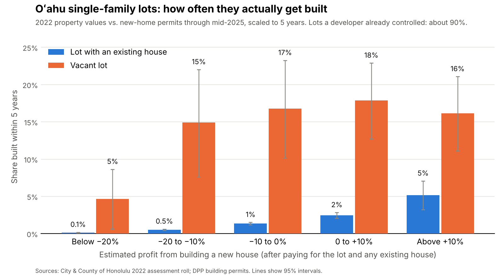

# Probability of development (p-dev)

Patrick Spence. Draft, November 2026.

## Purpose

Feasim estimates whether a project is financially feasible on a given parcel. It does not estimate how likely that parcel is to be built within the next five years, and that likelihood is what turns feasible capacity into expected housing production. This folder holds the estimates for that step and the parameters the tool reads.

## Method

An owner builds when the value of a new project exceeds the property's current value plus the cost of construction. For each parcel, the profit ratio compares the new project's value with that parcel's own assessed land and building value, rather than with a uniform land price. The build rate at each profit level is measured, not assumed: every Honolulu new-home permit from January 2022 to June 2025 was matched to the 2022 assessment roll.

## Results

| Parcel type | Share built within 5 years |
|---|---|
| Owner-occupied house | Typical Oʻahu lot: about 1% at break-even, 2% at a 10% profit, 3% at a 20% profit. |
| Rented house or second home | Typical Oʻahu lot: about 2.5% at break-even, 4.5% at a 10% profit, 7% at a 20% profit. Owner-occupied houses are rebuilt at about 40% of this rate. |
| Vacant lot | About 11% at a 20% loss, 16% at break-even, 21% at a 20% profit. Lots at a 40% loss or worse are almost never built (1 of 112 on Oʻahu). |
| Lot in an active developer subdivision | Up to about 90%. This is an upper bound: these lots were identified by clusters of construction, which inflates the rate. |
| 201H project approved by Council | About 77% of projects (90% of units) had a building permit 3–4 years later. |

The full curves are in `pdev_table.csv`; the tool reads `pdev_params.json`.

Expected new homes for any set of parcels = the sum over parcels of (probability of development) × (net new units). The model estimates totals. It does not predict which individual parcels will be built.

## Validation

- Geographic holdout. Fitted on the other TMK zones, the model predicts the Oʻahu total within about 10%. Individual zones are off by about 30% on average, with urban Honolulu under-predicted.
- Holdout by year: the model fails this test. Fitted on January 2022 – September 2023 and tested on October 2023 – June 2025, it under-predicts by 32–42%. Rebuilding on existing lots roughly halved in 2023 and recovered in 2024. Mortgage rates and home prices do not explain the swing.
- Market cycle. Rebuilding on existing lots during the 2022 – mid-2025 fitting window ran at 76% of the 2005–2025 average. For a typical five-year period, results should be multiplied by about 1.3 (range 1.05–1.44, from every five-year window since 2005).
- Other islands. Average vacant-lot build rates were measured directly, using the same rules, on Oʻahu (2.3% a year), Maui (2.5%) and Hawaiʻi County (2.1–2.7%). Kauaʻi publishes no assessed values, so it uses the median of the other islands. The existing-house curve can only be fitted on Oʻahu, because only Honolulu publishes parcel-level permits. A version based on lot characteristics predicted Maui within 12%, but not Hawaiʻi County, where land values are very low.
- Mainland comparison. In eight Arizona and Oregon counties (2.1 million parcels), vacant lots outside developer subdivisions are built at 2–4% a year, the same range as Hawaiʻi. The mainland county median predicts each Hawaiʻi area within about 30%. A detailed parcel-level mainland model did not transfer to Hawaiʻi and is not used.

## Variables tested

Each variable was evaluated on out-of-sample predictions, with neighborhoods held out, across all 157,402 parcels in the test sets. The parcels were joined to the USGS 10 m slope raster and to the State's FEMA flood, extreme-tsunami, 3.2 ft sea-level-rise, lava and wildfire-risk layers.

Retained for existing houses (Oʻahu):
- Owner-occupied (homeowner exemption): 0.43× the rebuild rate.
- Building value relative to land value: each doubling lowers the rate to about 0.8×. Houses with little building value for their lot are replaced more often.
- Steep lot (20% or greater slope, 11.5% of lots): 0.50×.
- Extreme-tsunami zone: 0.73×. Sea-level-rise (3.2 ft) zone: 0.72×.
- Together, these variables improved out-of-sample fit over profit and owner occupancy alone.

Rejected:
- FEMA flood zone: no effect on rebuilds or on vacant lots.
- Slope on vacant lots: no improvement, since land value already reflects it.
- Hawaiʻi County lava zones: slightly lower rates, but too small an improvement to include.
- High wildfire risk: vacant lots in these areas are built more often (1.3×). This reflects where growth occurs (dry leeward areas), not fire risk, so it is excluded.
- Houses built since 2005, zoning district and lot size: no improvement once profit is included.

## Limitations

- Apartment and commercial zones. Too few were built in 2022–2025 to fit a curve. The TOD, parking and fee scenarios currently use the single-family curve. That is an assumption, not a measurement. Assessment rolls for 2010–2021 would allow a direct estimate.
- ADUs are not modeled. Honolulu permits since 2016 suggest that new options take about two years to ramp up.
- Individual parcels. The model estimates totals and does not identify which parcels will be built.
- Large market shifts. The ranges above reflect historical variation and are not a forecast.

## Files

- `pdev_params.json`, `pdev_table.csv`: model parameters and curves.
- `results/`: charts, zone-level checks, out-of-sample tests, quarterly rebuilding counts and the AZ/OR/HI county table.
- `code/oahu/`: builds the Oʻahu dataset, fits the curve and runs the tests (Python 3.11; pandas, numpy, scipy, shapely, statsmodels, matplotlib).
- `code/hawaii_islands/`: Maui and Hawaiʻi County measurements, slope and hazard joins, and the island chart.
- `code/mainland_check/`: the Arizona and Oregon comparison.
- `DATA_SOURCES.md`: the source of every dataset. Raw data is not committed; the scripts expect it in the working folder.

Analysis was conducted with AI assistance (Claude).
