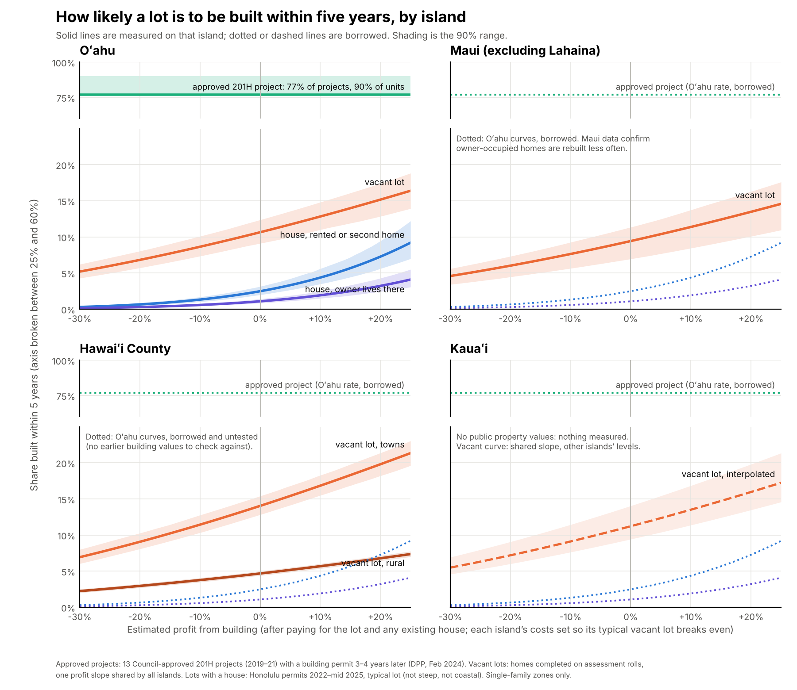

# Probability of development (p-dev)

Patrick Spence. Draft, November 2026.

## Purpose

Feasim, the parcel-level pro forma model in this repository, estimates whether a housing project is financially feasible on a given parcel. It does not estimate how likely that parcel is to actually be built within the next five years. That likelihood is what turns feasible capacity into expected housing production. This folder holds the estimates for that step and the parameters the simulator reads.

## Method

An owner builds when the value of a new project exceeds the property's current value plus the cost of construction. For each parcel we compute a profit ratio:

> profit ratio = value of the new project ÷ (construction and soft costs + the parcel's current assessed land value + its current assessed building value)

A ratio of 1.0 is break-even. "10% profit" means a ratio of 1.10; "20% loss" means 0.80. Using each parcel's own assessed value, rather than one land price for every parcel, means an existing house counts as a cost of redevelopment.

The share of parcels built at each profit level is measured, not assumed:

- Parcels with an existing house (Oʻahu): every Honolulu new-home building permit issued January 2022 – June 2025 was matched to the 2022 assessment roll.
- Vacant parcels (Oʻahu, Maui, Hawaiʻi County): a parcel counts as built when a new building appears on a later assessment roll (Oʻahu 2022 to 2026 and Maui 2020 to 2025; in Hawaiʻi County, a statewide dwelling-units layer from about October 2022 compared with the 2026 roll).

Each curve is a logistic function of the profit ratio, fitted to annual probabilities and converted to a five-year probability. Only single-family residential zones are covered (see Limitations).

Two definitions used throughout:

- Developer subdivision: a group of vacant lots being built out as one project, so its timing is set by the developer's schedule rather than by individual owners. Identified as a tax-map plat (Hawaiʻi's parcel numbering groups neighboring lots into plats) with at least five new homes on vacant lots during the window. For the cross-island vacant-lot curves, the group can also be a 400 m grid cell, and its annual build rate must be at least 5.6%. These lots are reported separately and excluded from the vacant-lot curves.
- Typical lot: a lot with the median building-to-land value ratio for Oʻahu (0.32), not steep and not in a coastal hazard zone.

## Results

Share of lots built within five years:

| Parcel type | 20% loss | Break-even | 20% profit |
|---|---|---|---|
| House, owner-occupied (typical Oʻahu lot) | 0.3% | 1.1% | 3.2% |
| House, rented or second home (typical Oʻahu lot) | 0.6% | 2.5% | 7.3% |
| Vacant lot, Oʻahu | 6.8% | 10.6% | 15.2% |
| Vacant lot, Maui | 6.0% | 9.4% | 13.5% |
| Vacant lot, Hawaiʻi County residential zones (RS/RD) | 9.1% | 14.0% | 19.8% |
| Vacant lot, Hawaiʻi County rural and small agricultural lots | 2.9% | 4.7% | 6.8% |
| Vacant lot, Kauaʻi (estimated, range in `pdev_table.csv`) | 7.2% | 11.2% | 16.0% |

Other cases do not depend on profit:

- Lot in an active developer subdivision: up to about 90% (Oʻahu, 141 lots). This is an upper bound. These lots were identified by where construction clustered during the same window, so the rate is inflated by the construction itself.
- Project approved under Chapter 201H of the Hawaiʻi Revised Statutes (a state law that lets the county council waive zoning and other rules for projects with affordable units): 77% of Oʻahu projects approved in 2019–2021, representing 90% of their units, had a building permit three to four years later.

Owner-occupied houses are identified by the homeowner property-tax exemption, which only applies to an owner's primary residence. They are rebuilt at about 40% of the rate of rented houses and second homes. On the other islands, the existing-house curves are borrowed from Oʻahu (see Validation).

The full curves are in `pdev_table.csv`, and the simulator reads `pdev_params.json`.

Expected new homes for any set of parcels = the sum over parcels of (probability of development) × (net new units). The model estimates totals. It does not predict which individual parcels will be built.

Observed rates on Oʻahu, grouped by profit and before any curve fitting, are shown below. The vacant-lot bars come from the smaller permit-matched sample and are noisy (wide intervals); the vacant-lot curves above use the larger assessment-roll sample from all three counties.

## Validation

All tests below are out-of-sample: the model is fitted on one part of the data and scored on parcels it has not seen.

- Geographic holdout. Oʻahu is divided into nine tax-map zones. Fitted on eight zones and tested on the ninth, in turn, the model predicts the Oʻahu total within about 10%. Individual zones are off by about 30% on average, with urban Honolulu under-predicted.
- Holdout by year: the model fails this test. Fitted on January 2022 – September 2023 and tested on October 2023 – June 2025, it under-predicts by 32–42%. Rebuilding on existing lots roughly halved in 2023 and recovered in 2024. Mortgage rates and home prices do not explain the swing.
- Market cycle. Rebuilding of existing houses on Oʻahu during the 2022 – mid-2025 fitting window ran at 76% of its 2005–2025 average. For a typical five-year period, multiply the probabilities by about 1.3 (range 1.05–1.44, the 10th to 90th percentile of five-year windows since 2005). This adjustment was measured on existing-house rebuilds, and assumes the slowdown affected all profit levels equally.
- Vacant lots on other islands. Vacant lots outside developer subdivisions were measured with the same rules on every island (residential and rural lots of 3,500 sq ft to 10 acres). Average build rates across all such lots are similar: Oʻahu 2.3% a year, Maui 2.5%, Hawaiʻi County residential zones 2.7% and rural lots 2.1%. All islands share one profit slope. On held-out plats, this predicts better than a flat rate and as well as a separate slope for each island. Construction costs are set separately for each island ($150 per sq ft on Oʻahu, $123 on Maui, $92 in Hawaiʻi County towns, $38 for rural lots) so that each island's median vacant lot is at break-even. This makes the curves comparable within an island, but not across islands.
- Kauaʻi publishes no assessed values, so nothing could be measured there. Its vacant-lot curve uses the average level of Oʻahu, Maui and Hawaiʻi County residential zones, with their range as the uncertainty band. Building permits per resident were tested as a way to place Kauaʻi among the other islands, but did not line up with the measured rates.
- Existing houses on other islands. The existing-house curve can only be fitted on Oʻahu, because only Honolulu publishes parcel-level building permits. An alternative model based on lot characteristics, which detects rebuilds from changes in assessed building value rather than permits, predicted Maui within 12%, but did not work in Hawaiʻi County, where land values are very low. Maui data also show owner-occupied homes being rebuilt less often.
- Mainland comparison. In eight Arizona and Oregon counties (2.1 million parcels), vacant lots outside developer subdivisions are built at 2–4% a year, the same range as Hawaiʻi. The mainland county median predicts each Hawaiʻi area within about 30%. A detailed parcel-level mainland model did not transfer to Hawaiʻi and is not used.

## Variables tested

Each variable was kept only if it improved out-of-sample predictions. For this test, the tax-map plats were split into five groups, each group was held out in turn, and the whole procedure was repeated three times with different splits. All 157,402 parcels in the test sets were joined to the USGS 10 m slope data (served by the Hawaiʻi Statewide GIS Program) and to the State's FEMA flood, extreme-tsunami, 3.2 ft sea-level-rise, lava and wildfire-risk layers.

Retained for existing houses (Oʻahu), as multipliers on the annual rebuild rate:

- Owner-occupied: 0.43×.
- Building value relative to land value: each doubling lowers the rate to about 0.8×. Houses with little building value for their lot are replaced more often.
- Steep lot (slope of 20% or more, 11.5% of lots): 0.50×.
- Extreme-tsunami evacuation zone: 0.73×. Area exposed to coastal flooding with 3.2 ft of sea-level rise: 0.72×.

Rejected:

- FEMA flood zone: no effect on rebuilds or on vacant lots.
- Slope on vacant lots: no improvement, since land value already reflects it.
- Hawaiʻi County lava zones: slightly lower rates, but too small an improvement to include.
- High wildfire risk: vacant lots in these areas are built more often (1.3×). This reflects where growth is happening (dry leeward areas), not fire risk, so it is excluded.
- House built since 2005, zoning district and lot size: no improvement once profit is included.

## Limitations

- Apartment and commercial zones. Too few were built in 2022–2025 to fit a curve. The simulator's transit-oriented development, parking-reduction and fee-reduction scenarios currently apply the single-family curves to these zones. That is an assumption, not a measurement. Assessment rolls for 2010–2021 would allow a direct estimate.
- Outcomes are not defined identically. Existing-house and 201H rates count building permits issued. Vacant-lot rates count new buildings recorded on the assessment roll, which comes later. Some permitted homes are never finished.
- The existing-house curve was fitted on profit ratios between about 0.6 and 1.25. Values outside that range are extrapolation.
- Accessory dwelling units (ADUs) are not modeled. After Honolulu began allowing ADUs (permits from 2016), annual ADU permits took about two years to reach a steady level.
- Individual parcels. The model estimates totals and does not identify which parcels will be built.
- Large market shifts. The ranges above reflect historical variation and are not a forecast.

## Files

- `pdev_params.json`: model coefficients, read by the simulator.
- `pdev_table.csv`: the same curves as a lookup table.
- `results/`: charts, zone-level checks, out-of-sample tests, quarterly rebuilding counts and the Arizona, Oregon and Hawaiʻi county table.
- `code/oahu/`: builds the Oʻahu dataset, fits the existing-house curve and runs the tests (Python 3.11; pandas, numpy, scipy, shapely, statsmodels, matplotlib).
- `code/hawaii_islands/`: Maui and Hawaiʻi County measurements, the vacant-lot curves, slope and hazard joins, and the island chart.
- `code/mainland_check/`: the Arizona and Oregon comparison.
- `DATA_SOURCES.md`: the source of every dataset. Raw data is not committed; the scripts expect it in the working folder.

Analysis was conducted with AI assistance (Claude).
